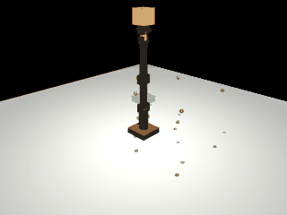
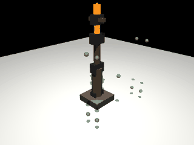
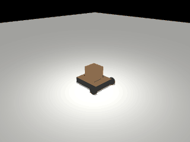
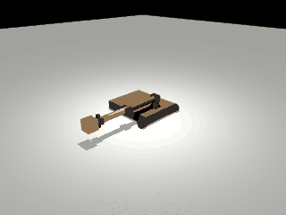
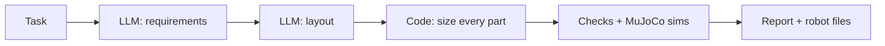
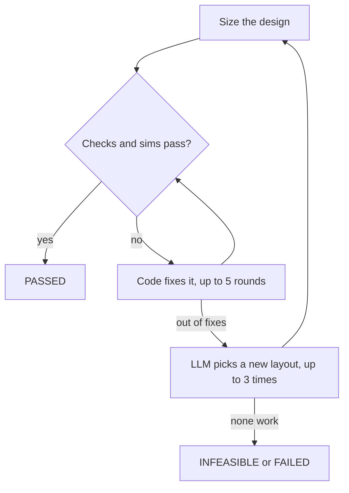
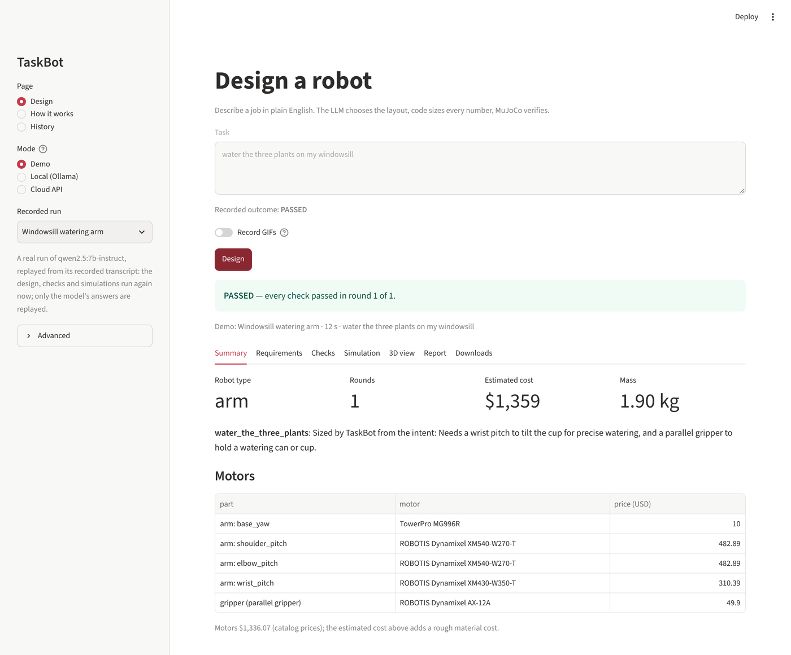
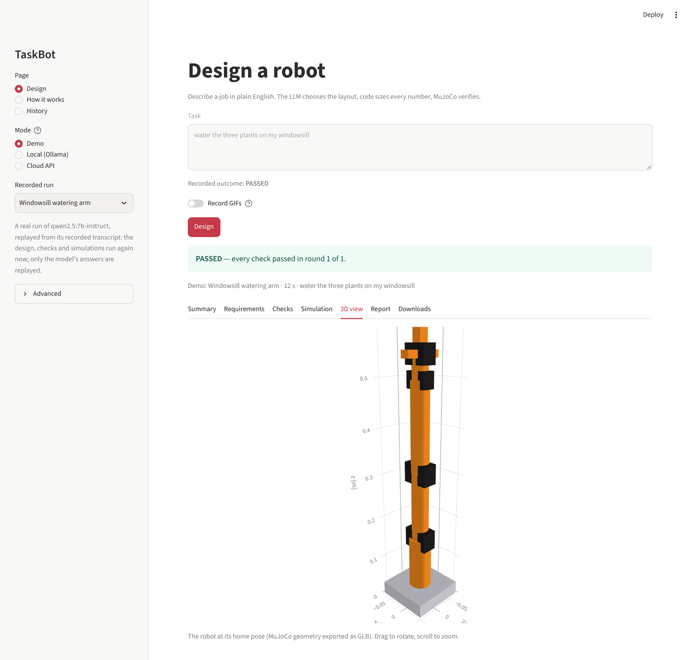
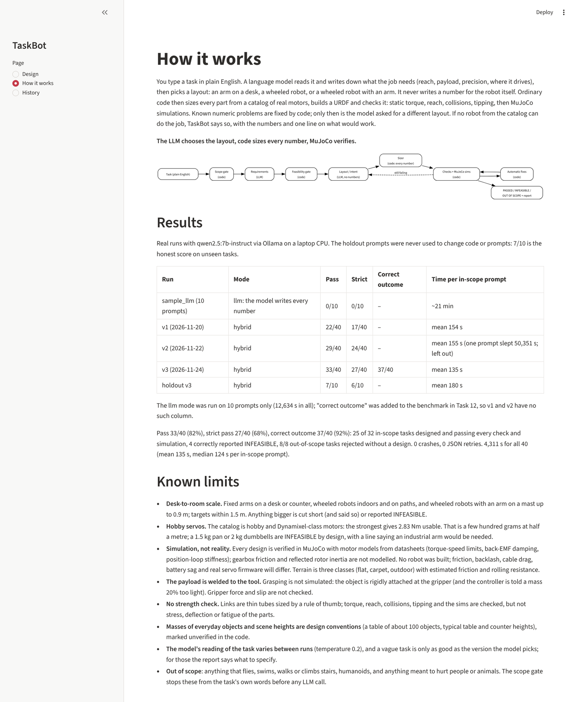

# TaskBot

I built TaskBot to turn a plain-English job description into a robot design that has been sized,
checked and simulated. An LLM chooses the layout; my code sizes every number; MuJoCo verifies.

| | | | |
|---|---|---|---|
|  |  |  |  |
| "water the three plants on my windowsill" | "a desk arm that picks M3 screws out of a tray..." (2 mm) | "a robot that carries a 2 kg box across my office" | "a robot that picks toys off the floor and drops them in a basket" |

MuJoCo recordings of designs made with qwen2.5:7b-instruct, replayed from the transcripts in
`tests/fixtures/real_runs/smoke_2026-11-07/`.



The LLM only describes the job and picks a layout; code works out every number.

## Install

Python 3.11+ and **MuJoCo 3.7 to 3.16**:

```bash
pip install -e ".[dev]" "mujoco>=3.7,<3.17"
pytest -m "not slow"                               # ~3 min; plain `pytest` runs everything (~12 min)
python -m taskbot.view examples/arm_4dof.json      # opens the MuJoCo viewer
```

> **MuJoCo version.** `pyproject.toml` asks only for `mujoco>=3.3`, so a plain install picks
> MuJoCo 4.x, where every simulation fails with a `TypeError`. MuJoCo 3.17+ wants 12 values in a
> weld's `data` (`sim/model.py` gives 11), and versions before 3.7 want a single number for joint
> `damping` (the code gives a list). Until the code handles both, install a version from 3.7 to 3.16.
> Every test passes on 3.16.0.

> **Headless Linux.** The Streamlit app and the tests set `MUJOCO_GL` themselves when there is no
> display, but the `taskbot` CLI, `bench/run.py` and the smoke test don't yet. Without it, recording
> GIFs crashes the process (exit 134) before `report.md` is written. Set it yourself:
> `export MUJOCO_GL=egl` (or `osmesa` with `libosmesa6` installed), or pass `--no-record`. Leave it
> unset on Windows and macOS.

## How it works

You describe a task. A language model writes down what the job needs (reach, payload, precision,
terrain) and picks a layout: an arm on a desk, a wheeled robot, or a wheeled robot with an arm. It
never writes a number for the robot itself. Plain code sizes every part (link lengths, joint ranges,
motors from a catalog of real hobby and Dynamixel servos, wheels, chassis, masses and inertia),
builds a URDF and checks it: static torque, reach, collisions and stability, then MuJoCo sims that
move to every target, carry the payload, hold still and drive. Code fixes what it knows how to fix;
only then is the model asked for a different layout. If no catalog robot can do the job, TaskBot
says so, with the numbers and one line on what would work, instead of returning a design that fails.

### The design loop



I started with a mode where the LLM writes the whole design (`--design-mode llm`). It passed 0 of 10
prompts at about 21 minutes each, which is why the default hybrid mode keeps every number in code.

The full engineering reference (how the sizer picks each number, where each safety margin is
applied, the feasibility gate, every check and simulation, robot types and terrain) is in
[docs/DETAILS.md](docs/DETAILS.md).

## Results

Real runs with qwen2.5:7b-instruct through Ollama on my laptop's CPU (per-prompt tables in
[docs/RESULTS.md](docs/RESULTS.md)):

| Run | Pass | Strict pass | Correct outcome | Time per in-scope prompt |
|---|---|---|---|---|
| llm mode (10 prompts) | 0/10 | 0/10 | – | ~21 min |
| hybrid v1 | 22/40 | 17/40 | – | ~2.6 min |
| hybrid v2 (scene-word fixes) | 29/40 | 24/40 | 33/40* | ~2.6 min |
| hybrid v3 (final) | **33/40** | **27/40** | **37/40** | ~2.3 min |
| holdout v3 (10 unseen prompts) | **7/10** | 6/10 | – | ~3 min |

\* v2's own report, before two expected outcomes were relabelled.

- **Pass**: an in-scope task gets a design that passes every check and sim, or an out-of-scope task
  (flying, swimming, legs, weapons) is rejected (8/8 in v3).
- **Strict pass** also needs the extracted requirements to match the prompt's expectations.
- **Correct outcome** (92%) counts PASS where a design is possible, an honest INFEASIBLE where it
  isn't (a 1.5 kg cast iron pan, a full 1 litre jug), and rejections.
- **Holdout 7/10** is the honest score on unseen tasks: written with the main set, kept aside, and
  nothing changed after seeing the results. The misses: 2 kg dumbbells (~20 Nm needed, 2.83 Nm
  available), shoes held just too far out (2.9 vs 2.83 Nm) and dog toys on a lawn.
- **0 crashes** in v3 and the holdout. The model samples at temperature 0.2, so a borderline prompt
  can flip between runs.

## Design a robot from a prompt

```bash
ollama pull qwen2.5:7b-instruct                                 # needs `ollama serve`
taskbot design "water the three plants on my windowsill"        # --backend ollama is the default
# -> out/<name>/report.md, run.json, requirements.json, spec.json, robot.urdf, rounds/, sim/

export OPENAI_API_KEY=sk-...
taskbot design "..." --backend openai                           # gpt-4o-mini by default; --model to change
taskbot design "..." --backend openai_compat                    # any OpenAI-compatible API (below)
taskbot design "..." --backend fake                             # offline, canned output
```

Useful flags: `--no-sim` skips the simulations, `--no-record` skips the GIFs, `--nearest` builds the
nearest feasible design (labelled APPROXIMATE, never a pass) when none fits, `--design-mode llm`
uses the old all-LLM mode. `--backend` defaults to `$TASKBOT_BACKEND`, `--model` to `$TASKBOT_MODEL`.

A reply that fails validation goes back to the model with the errors (up to 3 times); HTTP 429/503
are retried with backoff. Code normalises and corrects what the model gets wrong, and every change
is listed under "Corrections made by code" in `report.md`. Every run, including failures, writes
`report.md` and `run.json` with its status, reason, LLM usage and time per step. API keys are never
printed, logged or written.

| Exit code | Meaning |
|---|---|
| 0 | passed |
| 1 | bad arguments or configuration |
| 2 | failed design, or APPROXIMATE |
| 3 | out of scope (a fixed word list checked before any LLM call, then the model's own verdict) |
| 4 | infeasible: no catalog motor can meet the requirements |
| 5 | LLM unusable (the report names a next step, e.g. "is Ollama running? try: ollama ps") |

**Record and replay.** Every run writes `llm_transcript.jsonl`. Replay it offline through today's
code with `--backend replay --transcript out/<name>/llm_transcript.jsonl`. `tests/fixtures/real_runs/`
holds real qwen2.5:7b transcripts that the tests replay.

### OpenAI-compatible backends

Set `TASKBOT_BASE_URL`, `TASKBOT_MODEL` and, if needed, `TASKBOT_API_KEY`
(`read -rs TASKBOT_API_KEY && export TASKBOT_API_KEY` keeps it out of your shell history).
`TASKBOT_TIMEOUT_S` sets the per-request timeout; `TASKBOT_JSON_MODE=0` turns off JSON mode for
providers that reject it.

| Preset | `TASKBOT_BASE_URL` | Example `TASKBOT_MODEL` |
|---|---|---|
| Ollama (local) | `http://localhost:11434/v1` | `qwen2.5:7b-instruct` |
| Groq | `https://api.groq.com/openai/v1` | `llama-3.3-70b-versatile` |
| Gemini | `https://generativelanguage.googleapis.com/v1beta/openai` | `gemini-2.0-flash` |
| OpenRouter | `https://openrouter.ai/api/v1` | `meta-llama/llama-3.3-70b-instruct:free` |

URLs and model names are from memory (unverified); check the provider's current model list.

**Ollama context length.** The prompts are several thousand tokens, and Ollama can silently drop
the start of a prompt that doesn't fit. The native backend (`--backend ollama`) sets `num_ctx`
itself (`TASKBOT_NUM_CTX`, default 16384). Through `/v1`, start the server with a larger context,
e.g. `OLLAMA_CONTEXT_LENGTH=16384 ollama serve`.

## Benchmark

`bench/prompts.yaml` has 40 prompts in six categories (easy_arm, hard_arm, mobile,
mobile_manipulator, vague, out_of_scope), each with an expected outcome and expectations about the
extracted requirements. `bench/holdout.yaml` has 10 more, scored separately; don't tune on them.

```bash
python bench/run.py --backend ollama --model qwen2.5:7b-instruct --limit 5   # a small slice
python bench/run.py --backend ollama --model qwen2.5:7b-instruct             # all 40 (resumes)
python bench/run.py --backend ollama --model qwen2.5:7b-instruct --split all # + holdout
python bench/run.py --compare bench/results/OLD.csv bench/results/NEW.csv
```

Reports go to `bench/results/<date>_<backend>_<model>.md` and `.csv`: pass rates overall and per
category, the most common failing checks, and the exact messages the model didn't fix. A stopped
run resumes when rerun with the same `--name`. `--prompt-timeout` (default 1800 s) and
`--call-timeout` mark slow prompts as timed out rather than failed. Use `--concurrency 1` on free
API tiers. `--backend fake` only tests the benchmark itself and reports no pass rate.

**Smoke test**: six everyday prompts, one line each: `scripts/smoke.sh ollama qwen2.5:7b-instruct`
(or `.\scripts\smoke.ps1` on Windows).

## Web app (Streamlit)

```bash
pip install -e ".[ui]" "mujoco>=3.7,<3.17"
streamlit run streamlit_app.py      # http://localhost:8501
```

- **Demo** (default): real recorded runs replayed through the code (sizing, checks and sims run
  again), so no LLM or key is needed.
- **Local (Ollama)**: checks that Ollama answers and the model is pulled with enough context.
- **Cloud API**: OpenAI, Groq, OpenRouter, Gemini or a custom OpenAI-compatible URL. The key is
  sent only to the provider.

Each run shows live progress with a Stop button, then tabs for the summary (motors, cost, mass),
requirements, checks, simulation GIFs, an interactive 3D view, the report and downloads.

**Streamlit Community Cloud**: use `streamlit_app.py` as the entry point with Python 3.11+. It
installs `requirements.txt` and `packages.txt` (`libosmesa6` for headless rendering). Pin MuJoCo
in `requirements.txt` too (see [Install](#install)). Put `OPENAI_API_KEY` or `TASKBOT_API_KEY` in the
app's Secrets. Local (Ollama) mode can't work there.

| | | |
|---|---|---|
|  |  |  |
| A demo run (windowsill arm) | The interactive 3D view | The How it works page |

An older Gradio app is still there: `pip install -e ".[app]"`, then `taskbot-app`.

## Layout

| Path | What |
|---|---|
| `src/taskbot/pipeline.py` | prompt → requirements → scope stop → design loop → outputs (shared by CLI and apps) |
| `src/taskbot/requirements.py`, `scene.py`, `normalize.py` | Requirements model, what the task's words say, the normaliser |
| `src/taskbot/feasibility.py`, `scope.py` | Bounds no design can beat; the out-of-scope gate |
| `src/taskbot/intent.py`, `sizing.py`, `autofix.py`, `hybrid.py` | The hybrid loop: LLM intent → code sizing → deterministic fixes → revised intent |
| `src/taskbot/design.py`, `repair.py` | The llm mode's design and repair loop |
| `src/taskbot/schema.py`, `build_urdf.py` | `RobotSpec` and its modules; spec → URDF with all mass and inertia |
| `src/taskbot/checks.py`, `mobile_checks.py` | Static engineering checks returning `CheckResult` |
| `src/taskbot/sim/`, `sim_tests.py`, `mobile_sim.py` | MuJoCo scene, IK, motor models and control, arm and driving sims, GIFs |
| `src/taskbot/llm.py`, `fake.py` | LLM backends (Ollama, OpenAI, OpenAI-compatible, fake, replay) |
| `src/taskbot/prompts/` | System prompts |
| `src/taskbot/data/motors.json` | Motor catalog with a source for every value |
| `src/taskbot/report.py`, `cli.py`, `view.py`, `export3d.py` | Report writer, CLI, viewer, GLB export |
| `streamlit_app.py`, `src/taskbot/ui/`, `src/taskbot/app.py` | Streamlit app and helpers; old Gradio app |
| `src/taskbot/bench.py`, `bench/` | Benchmark |
| `examples/` | 2-, 4- and 6-DOF arms |

## Development rules

- The LLM chooses the layout; code sizes every number. The LLM only writes JSON matching a Pydantic
  schema. SI units everywhere.
- Every check returns `CheckResult{check, passed, value, limit, cause, message}`, with a message
  specific enough for an LLM to act on.
- I never tune gains, tolerances or test settings, or loosen a check, to make a design pass. When a
  model fails, I fix the messages and prompts, not the checks.
- Values from memory rather than a source are marked unverified.
- Small tested steps; a commit that changes an existing test says which and why.
- Windows too: `encoding="utf-8"` on every text read and write, and `.as_posix()` paths in reports.
- No API keys in code, logs, reports or commits. Tests use the fake backend, recorded transcripts
  or the mocked server in `tests/openai_mock.py`, and I never claim real-model results from them.
- Lint: `python -m pyflakes src tests bench`.

## Known limits

- **Desk-to-room scale.** Fixed arms, wheeled robots indoors and on paths, and wheeled robots with
  an arm on a mast up to 0.9 m; targets within 1.5 m.
- **Hobby servos.** The strongest catalog motor gives 2.83 Nm usable: a few hundred grams at half a
  metre. Heavier jobs are reported INFEASIBLE, with a line saying an industrial arm would be needed.
- **Simulation, not reality.** Motor models come from datasheets, but gearbox friction, backlash,
  cable drag and battery sag are not modelled, and I haven't built any of these robots.
- **No grasping or strength checks.** The payload is welded to the tool, and links are sized by a
  rule of thumb with no stress or deflection check.
- **Three arm layouts** in hybrid mode (`yaw_pitch_pitch`, `yaw_pitch_pitch_pitch`,
  `yaw_pitch_pitch_wristroll`). No SCARA or 6-DOF yet.
- **The model's reading of the task varies** between runs, and a vague task is only as good as the
  version the model picks; the report says what to specify.
- **Out of scope**: anything that flies, swims, walks or climbs stairs, and anything meant to hurt
  people or animals.

More technical limits (PID wind-up, no velocity feedforward, steppers not modelled) are in
[docs/DETAILS.md](docs/DETAILS.md#known-technical-limits).
