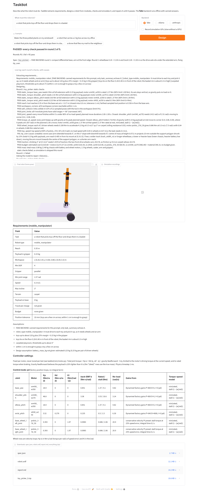

# TaskBot

Text-to-robot design with an LLM in the loop: plain-English task → measurable
requirements → module JSON (Pydantic schema) → deterministic URDF →
engineering checks and MuJoCo tests → plain-language feedback to the LLM.

```bash
pip install -e ".[dev]"
pytest
python -m taskbot.view examples/arm_4dof.json      # opens the MuJoCo viewer
```

## Project rules

These apply to every change (`CLAUDE.md` repeats them for coding agents):

- Python 3.11+, package `taskbot` under `src/`, tests with pytest under `tests/`.
- The LLM only writes JSON matching the Pydantic schema. All geometry, mass and inertia come
  from deterministic code.
- SI units everywhere.
- Every check returns `CheckResult{check, passed, value, limit, cause, message}`, with a message
  specific enough for an LLM to fix: name the part, give the numbers, say what to change.
- Controllers come from motor datasheets and fixed documented presets. Never tune gains,
  tolerances or test settings, or loosen a check, to make a design pass.
- Values from memory rather than a source are marked unverified.
- Small tested steps; don't build beyond the current task.
- Read and write text files as UTF-8 explicitly, and write paths into reports and CSVs with
  forward slashes, so everything works on Windows too.

## Design a robot from a prompt

```bash
pip install -e ".[anthropic]"
export ANTHROPIC_API_KEY=sk-ant-...
taskbot design "water the three plants on my windowsill"
# -> out/<name>/report.md, requirements.json, spec.json, robot.urdf, rounds/round_N/

taskbot design "..." --backend openai_compat                          # any OpenAI-compatible API (below)
taskbot design "..." --backend ollama --model qwen2.5:7b-instruct   # local, needs `ollama serve`
taskbot design "..." --backend fake                                   # offline, canned output
```

The design is checked (static torque, reach, workspace corners, self-collision,
joint ranges, budget, mass); once those all pass, it is simulated in MuJoCo
(`reach_targets`, `carry_payload`, `hold_still`). Failures go back to the LLM for
repair, up to `--max-rounds` (default 5). `report.md` shows each round's results,
a diff of what changed, the final pass/fail and GIFs of the final round's
simulations (`sim/*.gif`). Exit code 0 = passed, 2 = never passed.
`--no-sim` skips simulation; `--no-record` skips the GIFs. Exit code 3 = out of scope (below).

Recording needs an OpenGL backend. On a headless Linux machine install one and
pick it before running, e.g. `apt install libosmesa6` and `export MUJOCO_GL=osmesa`
(or `libegl1` and `MUJOCO_GL=egl` with a GPU). Without one, the GIFs are skipped
and the report says why.

`--backend` defaults to `$TASKBOT_BACKEND` (else `anthropic`); `--model` defaults to
`$TASKBOT_MODEL` (else the backend's default). If a reply fails validation, the errors
are sent back to the model and it retries, up to 3 times. Rate-limit errors (HTTP 429/503)
are retried with exponential backoff, honouring `Retry-After`. Every run writes `run.json`
and an "LLM usage" section in `report.md`: provider, model, calls, tokens, JSON validation
retries, rate-limit waits and time. API keys are never printed, logged or written.

### OpenAI-compatible backends (`--backend openai_compat`)

Configured with three environment variables: `TASKBOT_BASE_URL`, `TASKBOT_MODEL` and
`TASKBOT_API_KEY` (optional; local Ollama needs none). JSON mode (`response_format:
json_object`) is requested; a provider that rejects it gets plain requests and the reply
is left to Pydantic validation and retries (`TASKBOT_JSON_MODE=0` turns it off up front).
`TASKBOT_TIMEOUT_S` sets the per-request timeout (default 600 s for a local URL such as
`localhost`, 120 s for a remote API). It is also in the web app's backend list. A reply cut off
at the provider's output limit (`finish_reason: length`) stops the run with a clear error
instead of a JSON retry.

**Context length with Ollama.** The design and repair prompts carry the schema, the motor
catalog, the spec and the round history: several thousand tokens. Ollama's default context
window is smaller than that in many versions, and it silently drops the *start* of a prompt
that doesn't fit, which is where the schema and catalog are. The native backend
(`--backend ollama`) sets `num_ctx` itself (`TASKBOT_NUM_CTX`, default 16384), refuses a prompt
that may not fit, and stops with an error if Ollama reports a full context. Through `/v1`
(`openai_compat`) the server's setting applies: start it with a larger context, e.g.
`OLLAMA_CONTEXT_LENGTH=16384 ollama serve` (recent Ollama versions; from memory, unverified).

Set the key without putting it in your shell history: `read -rs TASKBOT_API_KEY && export TASKBOT_API_KEY`.

| Preset | `TASKBOT_BASE_URL` | Example `TASKBOT_MODEL` | Key |
|---|---|---|---|
| Ollama (local) | `http://localhost:11434/v1` | `qwen2.5:7b-instruct` | none |
| Groq | `https://api.groq.com/openai/v1` | `llama-3.3-70b-versatile` | console.groq.com |
| Gemini | `https://generativelanguage.googleapis.com/v1beta/openai` | `gemini-2.0-flash` | aistudio.google.com |
| OpenRouter | `https://openrouter.ai/api/v1` | `meta-llama/llama-3.3-70b-instruct:free` | openrouter.ai |

The URLs and model names are from memory, not checked against the providers' current
docs (unverified), and free-tier models and limits change: check the provider's model list.

```bash
export TASKBOT_BASE_URL=http://localhost:11434/v1 TASKBOT_MODEL=qwen2.5:7b-instruct   # Ollama
taskbot design "water the three plants on my windowsill" --backend openai_compat
```

## Running the benchmark

`bench/prompts.yaml` has 40 prompts in six categories (easy_arm 8, hard_arm 6, mobile 6,
mobile_manipulator 6, vague 6, out_of_scope 8), each with expectations about the extracted
requirements (robot type, minimum reach, payload, tolerance range, or `should_reject: true`).
`bench/holdout.yaml` has 10 more, scored separately: don't use them while improving prompts.

`bench/run.py` runs each prompt through the full pipeline (2 at a time by default,
`--concurrency`), retrying rate-limit errors with backoff (`--retries`, `--backoff`). It writes
`bench/results/<date>_<backend>_<model>.md` and `.csv`: pass rate overall and per category,
the holdout score separately, average rounds to pass, out-of-scope rejection accuracy, the most
common failing checks and causes, links to each prompt's report, and an **Unfixed failures**
section with the exact messages the model was given and didn't fix, grouped by cause.
A prompt passes when an in-scope task ends with a design passing every check and sim, or an
out-of-scope task is rejected. A **strict pass** also meets every expectation about the
extracted requirements (robot type, reach, payload, tolerance, terrain): a design that passes
its checks for the wrong requirements is a pass, not a strict pass. Both rates are reported.

The run's state is in `bench/results/<name>/results.jsonl`. If it stops (rate limit, crash,
Ctrl-C), run the same command again to continue; on a later day add `--name <name>`.
Rate-limited and errored prompts are retried on resume; finished ones are not.

Start with a small slice, then the full set, then the holdout:

```bash
# Ollama (local, no key): the native backend, which sets the context length itself
ollama pull qwen2.5:7b-instruct
python bench/run.py --backend ollama --model qwen2.5:7b-instruct --limit 5
python bench/run.py --backend ollama --model qwen2.5:7b-instruct              # all 40 (resumes)
python bench/run.py --backend ollama --model qwen2.5:7b-instruct --split all  # + 10 holdout

# A free API tier (Groq shown; see the presets above), one prompt at a time
export TASKBOT_BASE_URL=https://api.groq.com/openai/v1 TASKBOT_MODEL=llama-3.3-70b-versatile
read -rs TASKBOT_API_KEY && export TASKBOT_API_KEY
python bench/run.py --backend openai_compat --limit 5 --concurrency 1
python bench/run.py --backend openai_compat --category out_of_scope --concurrency 1
python bench/run.py --backend openai_compat --split all --concurrency 1

# Compare two runs of the same model (e.g. before/after a prompt change)
python bench/run.py --compare bench/results/OLD.csv bench/results/NEW.csv
```

`--compare` lists the prompts that got better (fail → pass) or worse, and refuses runs from
different models unless `--allow-different-models` is given. `--no-sim` skips the simulations,
`--record` renders GIFs.

`--backend fake` runs the benchmark offline. It has scripted answers for only a few prompts
(the rest are recorded as "no fake response" and not counted), and its report starts with
**FAKE BACKEND — scripted responses. Tests the benchmark itself only. Not a measure of design
ability.** with no headline pass rate.

## Robot types

The requirements step picks `robot_type` and explains why in its assumptions:

| Type | When | Modules |
|---|---|---|
| `arm` | the work happens in one place | `fixed_base`, `arm_chain`s, optional `gripper` |
| `mobile` | travel and carry things on the body, never pick anything up | `wheeled_base` |
| `mobile_manipulator` | travel and pick/place/handle objects | `wheeled_base`, `arm_chain` (with `mount_xy_m` on the chassis top), optional `gripper` |

Anything else (flying, swimming, legged walking, humanoids, climbing stairs), and anything
meant to hurt people or animals, gets an assumption starting `OUT OF SCOPE:`; the pipeline stops before designing and writes `report.md` saying why
(exit code 3).

**Wheeled base**: `drive` `differential` (two driven wheels at x = +wheelbase/2, plus a caster at
−wheelbase/2 when `caster: true`) or `four_wheel` (skid steering, no caster); `wheel_radius_m`,
`wheel_width_m`, `track_width_m`, `wheelbase_m`, `chassis_size_m` (a 3 mm-wall shell box) and
`chassis_material`, `wheel_motor_id`, and `battery_mass_kg` (default: an estimate of 0.25 kg per
pair of driven wheels, recorded as an assumption in the report). Wheel motors must support
`"velocity"` mode in the catalog's `modes`; arm and gripper motors must support `"position"`.
Wheels are continuous joints with velocity-controlled torque actuators, the caster is a ball
joint, and in the driving sims the chassis has a free joint.

**Terrain** (`build_urdf.TERRAIN`; estimates for rubber wheels, unverified):

| Terrain | Friction μ | Rolling resistance c_rr |
|---|---|---|
| `flat` (hard floor) | 0.8 | 0.01 |
| `carpet` | 0.6 | 0.03 |
| `outdoor` (paths, short grass) | 0.5 | 0.05 |

Rolling resistance is MuJoCo's rolling friction (c_rr · r, condim 6); the floor has near-zero
friction so each contact uses the wheel's (MuJoCo takes the larger of the two).

## Web app

```bash
pip install -e ".[app]"
taskbot-app            # http://127.0.0.1:7860 ; TASKBOT_OUT sets the output folder
```

A prompt box, backend choice (fake works without any API key) and a Design button; a live log
of each round's checks with their causes; a 3D view of the final robot (a GLB exported from the
MuJoCo geometry, `taskbot/export3d.py`); the simulation GIFs (optional, slow without a GPU); the
requirements with assumptions; the controller table; and downloads of `spec.json`,
`robot.urdf`, `report.md` and a zip of everything.



## Layout

| Path | What |
|---|---|
| `src/taskbot/schema.py` | `RobotSpec` and its modules (`fixed_base`, `wheeled_base`, `arm_chain`, `gripper`) — the only thing the LLM writes |
| `src/taskbot/data/motors.json` | Motor catalog with a source for every value |
| `src/taskbot/build_urdf.py` | `RobotSpec` → URDF; all mass and inertia computed here |
| `src/taskbot/view.py` | Spec JSON → URDF → MuJoCo viewer |
| `src/taskbot/llm.py` | `LLMClient.complete_json` + Anthropic, OpenAI-compatible, Ollama and fake backends |
| `src/taskbot/requirements.py` | `Requirements` model and the prompt → requirements step |
| `src/taskbot/design.py` | Requirements → `RobotSpec` step |
| `src/taskbot/prompts/` | System prompts |
| `src/taskbot/sim/` | Scene building, IK, PD + gravity-compensation control, GIF recording |
| `src/taskbot/sim_tests.py` | Simulation tests generated from the requirements |
| `src/taskbot/repair.py` | design → check → simulate → repair loop |
| `src/taskbot/report.py` | Writes `out/<name>/` and `report.md` |
| `src/taskbot/cli.py` | `taskbot design "<prompt>"` |
| `src/taskbot/checks.py` | Engineering checks and `CheckResult` |
| `src/taskbot/mobile_checks.py` | `wheel_torque`, `top_speed`, `tip_over`, `traction` |
| `src/taskbot/mobile_sim.py` | Driving sims: `drive_straight`, `turn_in_place`, `incline`, `drive_with_arm_extended` |
| `src/taskbot/pipeline.py` | prompt → requirements → (out-of-scope stop) → repair loop → outputs, shared by CLI and app |
| `src/taskbot/fake.py` | Offline fake backend with canned arm, mobile and mobile-manipulator runs (`data/fake/`) |
| `src/taskbot/export3d.py` | Final robot → GLB for the app's 3D view |
| `src/taskbot/app.py` | Gradio app (`taskbot-app`) |
| `src/taskbot/bench.py`, `bench/` | Evaluation benchmark: prompts, runner, reports, compare |
| `examples/` | 2-, 4- and 6-DOF arms |

## Geometry conventions

* Modules are listed root-first: one base (`fixed_base` or `wheeled_base`), arm chains, then at most one `gripper`.
* A wheeled base's frame is on the ground under the chassis centre, x forward, z up; an arm's
  `mount_xy_m` places its first joint on the chassis top.
* Each link extends along its own +z from the joint that drives it; the next joint is at its tip.
* A joint's motor is mounted on the parent link at the joint.
* URDF effort/velocity limits are the motor's stall torque and no-load speed.
  Prismatic joints assume a 10 mm rack-and-pinion radius.

## Check details

| Check | Passes when |
|---|---|
| `static_torque` | Each arm joint's gravity torque — chain straight and horizontal, payload at the tool point — is at most 80% of the motor's rated torque |
| `reach` | Tool reaches `reach_m` from the base axis at mid-workspace height, within 1 cm |
| `workspace_corners` | All 8 workspace corners are reachable within 1 cm |
| `self_collision` | ≤ 5% of random in-limit poses (tool inside the workspace) have non-adjacent links interpenetrating |
| `joint_limits` | Every revolute joint spans ≥ `min_joint_range_rad` (default 90°) and stays within ±2π |
| `joint_speed` | Every planned move can finish within 5 s with no joint above 80% of its no-load speed |
| `torque_at_speed` | At each move's mid-point (peak speed), every joint's gravity torque is below what its motor gives at that speed |
| `budget` | Motor prices + rough material cost ≤ `max_budget_usd` |
| `mass` | Always passes; warns if a desk-scale robot (reach ≤ 1 m) is over 5 kg |

Mobile robots get these instead of the arm-only checks (a mobile manipulator gets both). The
loads are the whole robot, `payload_kg` at the tool point and `base_payload_kg` on the chassis top.

| Check | Passes when |
|---|---|
| `wheel_torque` | Torque per driven wheel to accelerate at 0.5 m/s² up `max_incline_deg` (rolling resistance included) ≤ the wheel motor's torque at `speed_m_s` (cause `saturated` if short even at rest, else `speed_limited`) |
| `top_speed` | 80% of the wheel motor's no-load speed × wheel radius > `speed_m_s` |
| `tip_over` | Centre of mass inside the support polygon shrunk 15%, for the arm stowed and extended in 8 directions, on flat ground and on the incline facing 8 directions (COM shifts h·tanθ downhill); cause `unstable` |
| `traction` | Climbing force < μ × normal load on the driven wheels (moment balance; a differential robot climbs forwards); cause `slip` |

Reach uses 2000 random poses and then refines the nearest ones with IK, because random
samples alone are too sparse for a 1 cm tolerance. All sampling uses fixed seeds.

## Simulation tests

Generated from the requirements; run only after every static check passes.

| Test | What happens | Passes when |
|---|---|---|
| `reach_targets` | IK to the workspace centre and 8 corners; a minimum-jerk move to each | Every target: error < tol by move end + 1 s and staying there, path deviation < 3 tol, overshoot < 2 tol |
| `carry_payload` | Same moves with a `payload_kg` cube welded to the tool | As above, and no joint saturates for > 0.2 s |
| `hold_still` | Hold the target pose with the highest torque load, with payload, for 5 s | Final error < tol, peak deviation < 3 tol (reported in µm) |

`tol` is the requirements' `position_tolerance_m`: the precision the task needs, estimated by the
LLM with a reason (5 mm when unclear). Path deviation is the distance from the tool to the
nearest point of the planned tool path: running late along the right path isn't a miss. That lag
behind the planned timing is reported in the message but not judged.

**Motors** (`taskbot/sim/motor.py`). Driving torque at speed w: servos and Dynamixels
`min(rated, stall · max(0, 1 − |w|/w0))`; steppers use their pull-out curve if the catalog has one,
otherwise rated torque up to 50% of no-load speed and a straight line to 0 (an approximation).
Braking torque is capped at rated: a motor brakes at least as hard as it holds, and putting braking
on the driving line would leave a falling arm with no torque. (Only a joint overspun past
w0·(1 + rated/stall) can see more, from back-EMF alone.)

**Move durations** are planned per move: `max(2 s, time so no joint exceeds 80% of its no-load speed)`.
Static checks `joint_speed` (every move doable within 5 s at ≤ 80% no-load speed) and
`torque_at_speed` (gravity at mid-move, where speed peaks, below the motor's torque at that speed)
run before any simulation.

**Control** is fixed per motor, never tuned per test, and listed in every report:
Dynamixels use their factory position-loop gains (`Kp = P/128 · stall/885 · 4096/2π`,
`Kd = D/16 · stall/885 · 4096/2π / 1000`, I = 0); hobby servos and steppers use one conservative
setting (stall torque at 20° error, no D or I). Every motor has back-EMF damping `b = stall/w0`
(steppers `rated/w0`), applied with the D term as MuJoCo joint damping. A host-side gravity
feedforward believes the payload is 20% lighter than it is ("ideal" report rows use the true mass).

**Control mode** is a design choice, `"control": "pd"` (default) or `"pid"`. "pid" adds one fixed
integral preset on Dynamixels (raw Position I Gain 100, the dynamixel_hardware_interface example
value; its conversion to N·m/(rad·s) assumes a 1 ms firmware cycle, unverified). Hobby servos and
steppers have no integral term either way.

**Failure causes.** Every sim failure (and the torque/speed static checks) carries a `cause`:
`saturated`, `speed_limited`, `compliance` or `unreachable`, explained to the LLM in `prompts/repair.md`.
Compliance failures include a per-joint stiffness breakdown and the fix options ranked by it
(a stiffer motor on the joint that sags most, "pid", shorter or lighter outer links, or
bringing the load closer to the base).

**Driving sims** (mobile types; the chassis is free on a solid floor, slopes by tilting gravity):

| Test | What happens | Passes when |
|---|---|---|
| `drive_straight` | Ramp at 0.5 m/s² to `speed_m_s`, drive 1 m by wheel odometry, stop | Heading error < 5°, distance error < 5% (wheel slip reported) |
| `turn_in_place` | Yaw feedback (rate 2 × error, ≤ 1 rad/s) to 90° | Error < 5° |
| `incline` | Drive 0.5 m up `max_incline_deg` | Covers the distance and never slides back > 10 mm (slip reported only) |
| `drive_with_arm_extended` | Mobile manipulators: drive 0.5 m with the arm extended front/left/back/right (within the yaw limits) and the payload | Tilt < 20° and tool within `tol` of its pose relative to the chassis |

For a mobile manipulator the arm tests above (`reach_targets`, `carry_payload`, `hold_still`) still
run, **with the wheeled base held fixed**; the report says so.

**Wheel speed control** is fixed per motor type with the same torque-speed limit as position mode:
Dynamixels use their factory Velocity P/I gains (`Kv = P/128 · stall/885 / 0.229 rpm`,
`Ki = I/65536 · … / 1 ms`; values and conversion unverified); DC gearmotors use one conservative PI
preset (stall torque at 25% speed error, integral time 0.2 s).

Mobile failure causes: `unstable` (would tip), `slip` (wheels lose traction), plus `saturated` /
`speed_limited` for wheel motors and `wrong_type` when the design is a different robot type
than the requirements.

Physics runs at 1 ms.

## Known limits / future work

- **No velocity feedforward.** Joints track moves with the motors' factory position loops plus
  gravity feedforward only, so they run behind the planned timing (back-EMF drag ÷ Kp). That lag
  is reported in `reach_targets` / `carry_payload` messages but never fails a test.
- **The PID integral winds up during moves.** With `"control": "pid"` the integral runs all the
  time, so tracking error during a move builds it up and leaves a few mm of error after the move.
  Future: integrate only while holding.
- **Steppers are not modelled.** The simulator treats a stepper as a PD servo; real steppers hold
  stiffly and then skip steps under overload. Steppers are marked `"supported": false` in
  `motors.json`, so the designer is never offered them; existing designs that use one still load.
